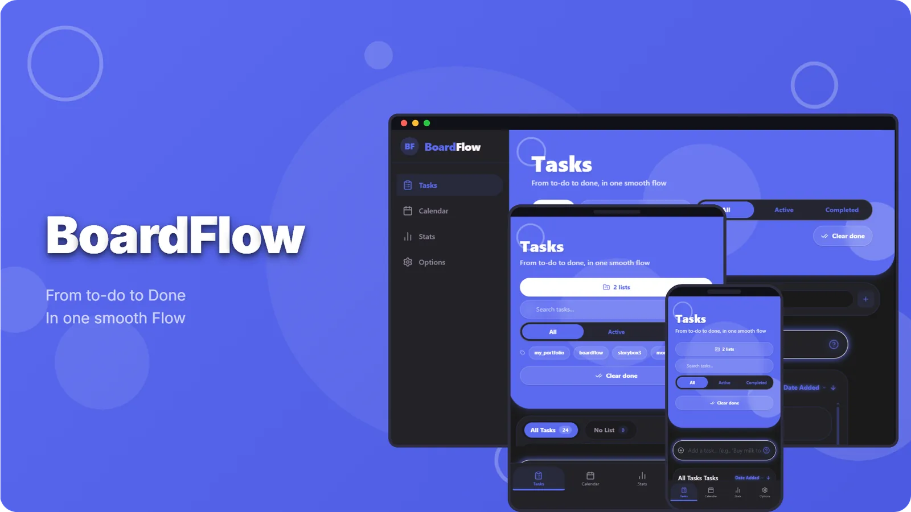

<div align="center">

# 📋 BoardFlow

**A hybrid native productivity app — tasks, notes, calendar, and stats, all local-first.**

[](#)
[](#)
[](#)
[](#)
[](#)
[](#)
[](#)

</div>

---

BoardFlow is a **local-first productivity app** that combines task management, notes, calendar, and statistics into one cohesive interface. It is for people who want one private workspace without accounts or cloud sync. It runs as a native desktop app (Windows, Linux, macOS) via Tauri and can be packaged for Android. Data stays on your device — no accounts, no cloud, no servers.

<p align="center">
  
</p>

## Visual identity

BoardFlow uses a bright periwinkle primary with warm pink and yellow details.
Light mode pairs it with a soft blush canvas; dark mode switches to charcoal
surfaces while keeping the blue accent.

| Theme | Canvas | Primary | Supporting colors |
|---|---|---|---|
| Light | `#FFF5F9` | `#5b6af0` | berry `#8B1D4B`, sun `#FFD23F` |
| Dark | `#1A1A1A` | `#5b6af0` | berry `#8B1D4B`, sun `#FFD23F` |

See the [visual identity guide](docs/visual-identity.md) and the canonical
tokens in [`src/index.css`](src/index.css).

---

## 📥 Download

Grab the latest build from the [Releases page](https://github.com/Omar-Khaled-57/board-flow/releases):

| Platform | Asset |
| :--- | :--- |
| Linux (recommended) | `BoardFlow_<version>_amd64.AppImage` — run directly, no install |
| Linux (alternative) | `BoardFlow_<version>_amd64.deb` / `_amd64.rpm` |
| Windows | `BoardFlow_<version>_x64-setup.exe` |
| Android | `BoardFlow_v<version>.apk` |

Linux assets are available from v1.0.2 onward (and backfilled onto older releases where the code still builds).

---

## ✨ Features

- **Task management** — create, edit, reorder, and organize tasks into lists with natural-language date parsing (e.g. "Buy milk tomorrow !!"), priorities, subtasks, and tags
- **Hashtags (any language)** — `#tags` work in tasks and notes with full Unicode support including Arabic (`#مذاكرة`, `#مشتريات`); hashtags written inside note content automatically become note tags on save and render as pills in the note view
- **Notes system** — full notes page with rich inline editing, tag support, task linking (`linkedTaskId`), file attachments, list management (rename/delete), and sort controls (date added, updated, title, tags)
- **Drag-and-drop reorder** — pointer-based drag with FLIP animations, ghost portal, and drop indicator on both tasks and notes
- **Undo/redo** — snapshot-based history (50 levels) with a floating snackbar; global `Ctrl+Z`/`Ctrl+Y` shortcuts
- **Calendar view** — monthly grid with task density per day, click-to-expand detail panel
- **Statistics** — daily goal tracking, completion streaks, progress indicators
- **Full backup & restore** — export all data (tasks, notes, tags, lists, settings, stats) as a single JSON file; a v2 import merges it into existing data by ID with relationships intact (settings and sort preferences are kept from the current session; imports are schema-validated; invalid entries are skipped and reported)
- **Android export** — uses the Tauri save dialog (SAF) like desktop; if no file can be written, falls back to clipboard/textarea export
- **Dark/light/system theme** — accent color picker, smooth transitions
- **Native notifications** — scheduled reminders at task due times ("Upcoming Deadline") via Tauri notification plugin; daily goal achieved alert ("Goal Achieved 🎯") with custom Android notification icons; Web Notification API fallback
- **Responsive layout** — sidebar on desktop, bottom nav on mobile, adapts to landscape
- **Testing** — 24 Playwright E2E tests + 45 vitest tests (stores, schemas + utilities)

---

## 🛠️ Tech Stack

| Category | Technology | Notes |
| :--- | :--- | :--- |
| App Shell | Tauri v2 | Native wrapper, desktop + Android packaging |
| Frontend | React 19 | Vite-bundled SPA with React Router |
| Language | TypeScript | Full type safety across frontend and schemas |
| Bundler | Vite 7 | Fast HMR and optimized production builds |
| Styling | Tailwind CSS v4 | Utility-first with `@custom-variant dark` for theme |
| State | Zustand 5 | Lightweight stores with `persist` middleware |
| Schemas | Zod 4 | Runtime validation for all persisted data |
| Icons | Lucide React | Consistent icon set |
| Storage | IndexedDB (via `idb-keyval`) | Primary persistence, localStorage fallback |
| History | Snapshot-based undo/redo | `past`/`future` arrays in the stores (50-level, capped) |
| NLP Dates | `chrono-node` | Natural language date parsing in task input |
| Backend | Rust (Tauri plugins) | Notifications, dialog, FS, store, opener — no custom commands registered |

---

## 📁 Project Structure

```
 📦 BoardFlow
 ┣ 📂 src                    # React frontend
 ┃ ┣ 📂 components           # Shared UI (Badge, PageHeader, ToggleSwitch, EmptyState, etc.)
 ┃ ┣ 📂 hooks                # Extracted hooks (useDragReorder, useClickOutside, useNotificationScheduler, useTheme)
 ┃ ┣ 📂 pages                # App screens (Tasks, Notes, NoteDetails, Calendar, Stats, Options)
 ┃ ┣ 📂 store                # Zustand stores (useTodoStore, useNotesStore, useStatsStore) + storage adapter + persist merges
 ┃ ┣ 📂 schemas              # Zod schemas for all persisted types (strict + import-tolerant variants)
 ┃ ┣ 📂 types                # TypeScript interfaces (Todo, Note, Settings, etc.)
 ┃ ┗ 📂 utils                # Helpers (id generation, date formatting, notifications, NLP)
 ┣ 📂 src-tauri              # Tauri backend (Rust) + build configuration
 ┃ ┣ 📂 src
 ┃ ┃ ┣ 📜 lib.rs             # Plugin registration only (no custom commands)
 ┃ ┃ ┗ 📜 main.rs            # Binary entry point
 ┃ ┣ 📂 capabilities/        # Tauri v2 capability permissions (FS scopes, dialog, notification, store)
 ┃ ┗ 📂 gen/android/         # Android native project generated by Tauri
 ┗ 📂 dev                    # Development notes and analysis files
```

The **storage architecture** is layered:
1. **Zustand stores** hold in-memory state with precomputed indexes (O(1) lookups by ID, list, tag, priority)
2. The **persist middleware** writes whole-store state through `src/store/storage.ts`, which picks the backend: Tauri Store plugin (`boardflow.dat`) on desktop/mobile, IndexedDB (`idb-keyval`) on web, `localStorage` fallback
3. **Zod schemas** validate every persisted value at rehydration and every imported backup; invalid entries are dropped (rehydration) or skipped and reported (import)

---

## 🚀 Development Setup

### Prerequisites

- Node.js 18+
- Rust (stable)
- Windows: Visual Studio C++ Build Tools
- Android: Android Studio + SDK + NDK
- iOS/macOS: Xcode

### Command reference

| Command | Purpose |
| :--- | :--- |
| `npm install` | Install JavaScript dependencies. |
| `npm run dev` | Run the web frontend only. |
| `npm run build` | Type-check and build the web frontend. |
| `npm run preview` | Preview the built web frontend. |
| `npm run tauri:dev` | Run the Tauri desktop dev shell. |
| `npm run test` | Run Vitest once. |
| `npm run test:watch` | Run Vitest in watch mode. |
| `npx playwright test` | Run the Playwright E2E suite. |
| `npm run appimage` | Build an AppImage. |
| `npm run linux` | Build AppImage, `.deb` and `.rpm`. |
| `npm run windows` | Build NSIS and MSI installers (on Windows). |
| `npm run tauri` | Tauri CLI passthrough for commands such as Android builds. |

### Install

```bash
npm install
```

### Run locally (Tauri desktop app)

```bash
npm run tauri:dev
```

### Run web frontend only

```bash
npm run dev
```

### Build desktop bundles

```bash
npm run tauri build
```

### Linux production build (AppImage — no Wine needed)

The app is a native GTK/WebKitGTK app on Linux; everything is built and packaged on Linux itself.

```bash
pnpm appimage            # AppImage only → src-tauri/target/release/bundle/appimage/
pnpm linux               # AppImage + .deb + .rpm
pnpm windows             # NSIS + MSI (cross-platform configs, build on Windows)
```

Requirements: Rust toolchain, `webkit2gtk-4.1` and `gtk3` dev packages, plus the usual Tauri Linux dependencies.

Two gotchas that can break the bundling step:

1. **No FUSE available** (containers/headless CI): run with `APPIMAGE_EXTRACT_AND_RUN=1`, e.g.
   `APPIMAGE_EXTRACT_AND_RUN=1 pnpm appimage`
2. **Old cached linuxdeploy fails to `strip` modern libraries** (`unknown type [0x13] section '.relr.dyn'`): replace the cached copy Tauri keeps at `~/.cache/tauri/linuxdeploy-x86_64.AppImage` with the latest continuous build from the [linuxdeploy releases](https://github.com/linuxdeploy/linuxdeploy/releases/tag/continuous), then rebuild.

### Build for Android

```bash
npm run tauri android build
```

### Run unit tests

```bash
npm run test              # run once
npm run test:watch        # watch mode
```

### Run E2E tests

```bash
npx playwright test
```

---

## 🧪 Tests

### Unit Tests (vitest)

45 vitest tests run in JSDOM with Tauri APIs mocked:

| File | Tests | Coverage |
| :--- | :--- | :--- |
| `useTodoStore.test.ts` | 13 | CRUD, toggle, undo/redo, order, tags, lists, settings, indexes |
| `useNotesStore.test.ts` | 8 | CRUD, undo/redo, sort prefs, order, updatedAt |
| `schemas.test.ts` | 12 | Strict + import-tolerant Zod validation for todos, notes, tags and goals |
| `nlp.test.ts` | 8 | Latin/Unicode hashtags, priorities, Arabic date terms |
| `id.test.ts` | 4 | Length, uniqueness, charset |

### E2E Tests (Playwright)

24 Playwright tests run in Chromium with auto-starting dev server:

| Spec | Tests | Coverage |
| :--- | :--- | :--- |
| `tasks.spec.ts` | 7 | Create, complete, filter, delete, search, clear completed, list management |
| `notes.spec.ts` | 4 | Create, empty state, search, navigation |
| `export-import.spec.ts` | 5 | Options page, export/import buttons, file input |
| `undo-redo.spec.ts` | 3 | Snackbar visibility, undo restores, redo reapplies |
| `theme.spec.ts` | 5 | Toggle light/dark, accent color selection |

```bash
npx playwright test          # run all
npx playwright test --ui     # interactive UI mode
```

---

## 🔄 Data Flow

```
User Action → Zustand Store → IndexedDB (persist)
                ↓
          Precomputed Indexes → O(1) lookups
                ↓
          Re-render via selectors
```

Undo/redo uses snapshot history for tasks and notes (50 levels), while the separate `History` class supports command-pattern batching for future features.

Export/import uses a versioned JSON schema (v1 per-list tasks, v2 full backup) with all relationships preserved by keeping original IDs intact.

---

## 📚 Documentation

The full documentation set lives in [`docs/`](docs/README.md): [product](docs/product.md),
[architecture](docs/architecture.md), [development](docs/development.md),
[configuration](docs/configuration.md), [testing](docs/testing.md),
[deployment](docs/deployment.md) and [changelog](docs/changelog.md). The
[visual identity guide](docs/visual-identity.md) and the running
[`CHANGELOG.md`](CHANGELOG.md) are kept where they were.

---

## 📄 License

Licensed under the [MIT License](LICENSE).

<div align="center">
  <i>Built with 🫩 by Omar Khaled El-Khouly.</i>
</div>

<div align="center">
  © 2026 Omar Khaled El-Khouly — created by Omar-Khaled-57 on GitHub.
</div>
